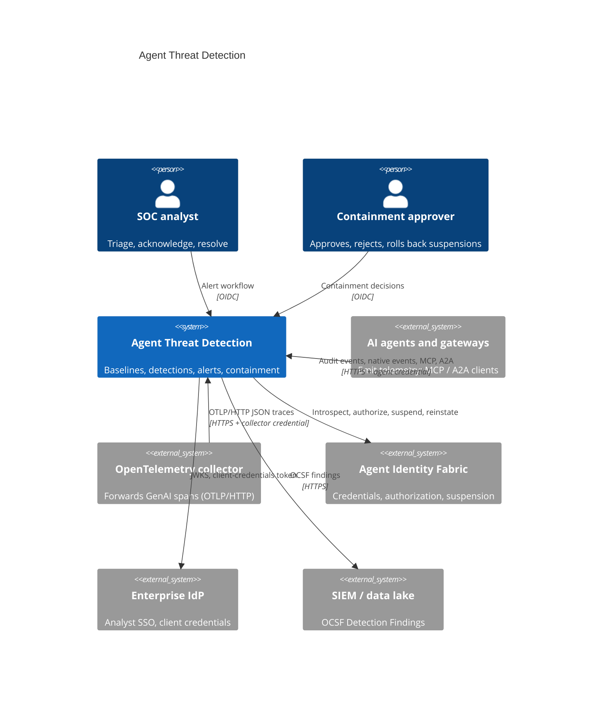
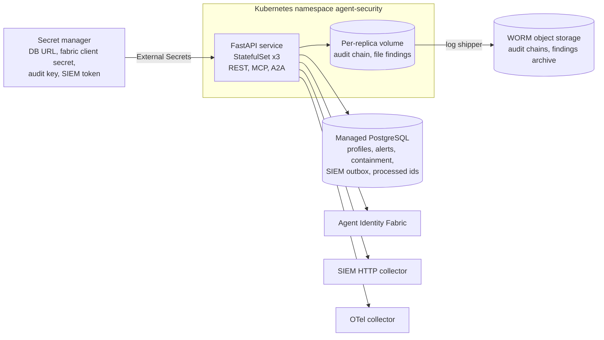
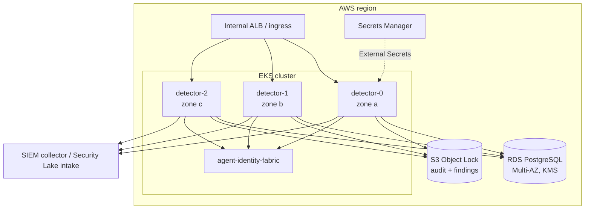

# Architecture

## Business problem

Enterprises now run fleets of AI agents that call tools, read regulated data,
delegate work to other agents and send data out of the network. Identity and
authorization decide what an agent *may* do; they cannot tell whether an
agent that holds valid credentials is *behaving* like itself. A prompt
injection in a retrieved document, a compromised tool, a poisoned plugin or a
stolen agent credential all produce activity that passes every authorization
check. Security operations teams need the same runtime detection for agents
that EDR and UEBA give them for hosts and users: a baseline of normal
behaviour per agent, detections for the attack patterns specific to agents,
findings in the SIEM in a standard schema, and a way to stop a misbehaving
agent quickly without taking down the platform.

This service provides that loop:

```
Telemetry -> Behavioural baseline -> Detection -> Scoring and dedup -> SIEM (OCSF)
                                                              \-> Containment (identity fabric)
```

## System context (C4 level 1)



## Containers (C4 level 2)



## Components (C4 level 3)

| Layer | Module | Responsibility |
|---|---|---|
| API | `api.app`, `api.routes`, `api.schemas` | REST contract, OTLP/HTTP intake, analyst OIDC, correlation IDs, Prometheus metrics, OAuth-style errors |
| Integrations | `integrations.mcp_server`, `integrations.a2a`, `integrations.agent_calls` | MCP tools over streamable HTTP; A2A Agent Card and JSON-RPC `message/send`; shared authorize-then-audit use cases |
| Application | `application.service.ThreatDetectionService` | Ingest by agent under a per-agent lock, dedup into alerts, atomic commit, analyst workflow, feedback learning |
| Application | `application.containment.ContainmentService` | Containment policy, automatic or approval-gated suspension, rollback, alert linkage |
| Detection | `detection.baseline` | Per-agent profile: Markov model, frequency, egress statistics, hours, windows, risk, quarantine |
| Detection | `detection.detectors` | Behavioural detectors (sequence, time, rate, privilege, delegation, exfiltration, injection) |
| Detection | `detection.sigma` | Sigma-style rule parser and evaluator (modifiers, conditions, count aggregations) |
| Detection | `detection.pipeline` | Detect, correlate (behaviour shift, risk), learn or quarantine, decide what is alertable |
| Domain | `domain.events`, `domain.findings` | Canonical `AgentEvent`, normalizers for audit and OTLP, signals, alerts, containment actions |
| Infrastructure | `infrastructure.database` | SQLAlchemy Core repositories with optimistic concurrency, outbox |
| Infrastructure | `infrastructure.fabric` | Typed identity-fabric client, client-credentials token source |
| Infrastructure | `infrastructure.siem` | OCSF 1.3 mapping, HTTP (OCSF array, Splunk HEC) and file sinks, outbox dispatcher |
| Security | `security.agents`, `security.analysts`, `security.jwks` | Inbound agent authorization (fabric or local policy), analyst roles, JWKS caching |
| Evaluation | `evaluation.simulator`, `evaluation.metrics` | Synthetic labelled traces and detection/false-positive measurement |
| Runtime | `runtime.container` | Composition root built from `Settings` |

Shared controls come from [agentic-core](https://github.com/kogunlowo123/agentic-core):
`PolicyEngine` (containment and inbound policy), `AuditLog` (signed hash
chain), `PromptInjectionDetector` and `SecretScanner` (content checks),
structured logging and OpenTelemetry setup.

## Detection model

Every event passes through four stages in `DetectionPipeline.process`:

1. **Detect.** Behavioural detectors compare the event with the agent's
   profile *before* it is learned; Sigma-style rules match the event and
   maintain their own count windows in the profile.
2. **Correlate.** If the agent ingested content with prompt-injection markers
   within the last 15 events / 15 minutes, any sequence, privilege,
   delegation, exfiltration or rule signal becomes an
   `injection.behavior_shift` (high or critical). Every signal adds to a
   decayed risk score (half-life one hour); crossing 0.8 from low-confidence
   signals alone raises `risk.threshold`.
3. **Learn or quarantine.** Clean events are learned. Events with only LOW
   signals are learned once the same anomaly key has recurred on three
   distinct days. Events with MEDIUM or higher signals are never learned.
   See [ADR-0002](adr/0002-learning-quarantine.md).
4. **Decide.** Signals at MEDIUM or above that are not suppressed by analyst
   feedback become alerts, deduplicated by `(agent, detector, rule, discriminator)`
   within one hour.

| Detector | Signal | Statistic |
|---|---|---|
| `sequence.anomalous_window` | A run of improbable steps | Mean surprise (−log2 p) of the last 8 steps in the session vs the agent's EW mean/std of per-step surprise; z ≥ 5 |
| `sequence.rare_transition` | One improbable step (LOW, evidence only) | n-gram Markov, order 3, Lidstone α = 0.1, back-off below 20 observations |
| `sequence.novel_tool` | Never-seen tool | MEDIUM when Good–Turing missing mass < 0.02, else LOW |
| `time.off_hours` | Activity in a rare hour | Laplace-smoothed 24-bin histogram < 0.004; once per hour |
| `frequency.rate_spike` | Events per minute | Mean + 6σ and ≥ 30 |
| `privilege.denial_burst` | Probing for permissions | ≥ 5 denials in 300 s |
| `privilege.classification_jump` | Data above the usual classification | Profile maximum |
| `privilege.scope_escalation` | New scopes requested | HIGH when wildcard or administrative |
| `delegation.cycle` / `depth` / `new_delegate` / `fanout` | Delegation abuse | Chain membership; depth > 3 or > baseline + 1; Good–Turing; ≥ 5 distinct in 600 s |
| `exfiltration.new_destination` | First egress to a host | Escalates for external and sensitive data |
| `exfiltration.volume` | Large transfer | z on log1p(bytes) ≥ 4 (medium) / 6 (high) |
| `exfiltration.window_volume` | Drip exfiltration | z of the 15-minute tumbling-window total ≥ 4 |
| `exfiltration.credentials` | Secrets leaving | agentic-core `SecretScanner` |
| `exfiltration.markdown_beacon`, `encoded_payload` | Covert channels | URL beacon pattern; long base64/hex runs |
| `injection.content` | Injected instructions ingested | agentic-core `PromptInjectionDetector` or upstream score ≥ 0.5 |
| `sigma` | Rule match | `rules/*.yaml` |

Measured detection and false-positive rates are in
[detection-evaluation.md](detection-evaluation.md).

## Sequences

### Telemetry to containment

```mermaid
sequenceDiagram
  participant C as Collector / agent
  participant D as Detector
  participant F as Identity fabric
  participant DB as PostgreSQL
  participant S as SIEM
  C->>D: POST /v1/events (bearer agent credential)
  D->>F: POST /oauth2/introspect, POST /v1/authorize (telemetry:write)
  F-->>D: active, allow (cached 30 s)
  D->>DB: load profiles; skip processed event ids
  D->>D: detect, correlate, learn/quarantine, dedup
  D->>DB: one transaction: profile (CAS), alerts (CAS), outbox, processed ids
  D->>D: containment policy for high/critical alerts
  alt critical, confidence >= 0.9, not protected
    D->>F: POST /v1/suspend?agent_uri=... (client-credentials admin token)
    F-->>D: status=suspended (credential epoch bumped)
  else otherwise
    D->>DB: containment pending_approval
  end
  D-->>C: accepted, alerts, containment ids
  loop every 5 s
    D->>DB: due outbox rows
    D->>S: OCSF Detection Findings
  end
```

### Approval and rollback

```mermaid
sequenceDiagram
  participant A as Containment approver
  participant D as Detector
  participant F as Identity fabric
  A->>D: POST /v1/containment/{id}/approve (OIDC, containment-approver)
  D->>D: requester != approver; status pending or failed
  D->>F: POST /v1/suspend
  F-->>D: suspended
  D-->>A: executed; alert status contained
  A->>D: POST /v1/containment/{id}/rollback
  D->>F: POST /v1/reinstate
  D-->>A: rolled_back
```

## MCP integration

`/mcp` serves the official MCP Python SDK (`MCPServer`, streamable HTTP,
stateless, JSON responses) so any replica answers any request.

| Tool | Action authorized | Purpose |
|---|---|---|
| `list_alerts` | `threat:read` | Deduplicated alerts filtered by status, agent and severity |
| `get_agent_risk` | `threat:read` | Baseline summary, decayed risk, active containment |
| `submit_events` | `telemetry:write` | Up to 1000 events through detection |
| `request_containment` | `containment:request` | Ask for suspension; always waits for a human when an agent asks |

Every tool has typed input and output schemas (`outputSchema` from the
Pydantic return types), is authorized per call through the identity fabric,
and writes an audit event. Requests without a bearer token are refused
before the MCP layer; DNS-rebinding protection checks the `Host` header
against `THREAT_MCP_ALLOWED_HOSTS`.

## A2A communication

`GET /.well-known/agent-card.json` publishes the Agent Card (protocol
0.3.0: name, description, url, version, capabilities, skills,
securitySchemes with an HTTP bearer scheme for fabric credentials).
`POST /a2a` accepts JSON-RPC 2.0 `message/send`. The skill comes from
`message.metadata.skill`, a `skill` key in a data part, or, for plain text, a
SPIFFE ID in the text (triage). Skills map onto the same use cases as the MCP
tools, so authorization and audit are identical. Errors use JSON-RPC codes:
−32700 parse, −32600 invalid request, −32601 method, −32602 params,
−32004 unsupported skill, −32050 authorization denied.

## Observability

- Prometheus metrics on `/metrics` (own registry): request latency, events by
  source, duplicates, rejected records, signals, alerts, open alerts by
  severity, containment outcomes, SIEM delivered/failed/backlog, inbound
  authorization outcomes, batch processing latency.
- OpenTelemetry traces through `FastAPIInstrumentor` and agentic-core setup
  (OTLP gRPC when `THREAT_OTLP_ENDPOINT` is set).
- JSON logs with correlation IDs and sensitive-key scrubbing.
- Alert rules in `configs/prometheus/alerts.yaml` (SLO burn, telemetry gap,
  critical alert, containment waiting or failed, fabric unreachable, SIEM
  backlog) and a Grafana dashboard in `configs/grafana/`.

## Deployment view (AWS reference)



Azure (AKS, PostgreSQL Flexible Server, Key Vault, immutable Blob) and GCP
(GKE, Cloud SQL, Secret Manager, retention-locked GCS) are provisioned by the
same Terraform layout in `deployments/terraform/{azure,gcp}`.

The chart deploys a StatefulSet because each replica writes its own signed
audit chain to its own volume. Detection state is in PostgreSQL, so replicas
are interchangeable for processing; profiles are versioned and a conflicting
write is retried by replaying the batch on the fresh profile. Collectors
should partition batches by agent (for example a Kinesis or Kafka partition
key of `agent_id`) to keep conflicts rare.

## CI/CD

`.github/workflows/ci.yml` runs on every push and pull request: ruff, black,
mypy `--strict`, bandit, contract drift (`contracts --check`), the test
suites with a 90% coverage gate on Python 3.12 and 3.13, PostgreSQL
integration tests, Helm lint/render/required-value check and kubeconform,
Terraform fmt/validate for three clouds, Trivy config scan, image build with
a smoke test, Trivy image scan, Syft SBOM and Grype gate, and Semgrep.
`release.yml` re-runs the quality gate on a `v*` tag, checks the tag matches
the package and chart versions, pushes the image with SBOM and provenance
attestation to GHCR, pushes the Helm chart to GHCR OCI, and creates a
GitHub release with the SBOM.

## Cost and scalability

| Driver | Behaviour |
|---|---|
| CPU | About 0.35 ms per event single-threaded (all detectors and nine rules, measured on the synthetic trace); a replica at one core handles on the order of 2,500 events/s before database time. HPA scales on CPU. |
| Database | One read and one transactional write per agent per batch, plus one alert lookup per new dedup key. Batching (up to 1000 events) amortizes the write; profiles are small JSON documents (a few KB to tens of KB). |
| Storage | Processed event ids are kept 48 hours; delivered outbox rows 7 days; alerts and containment records for the retention period of the deployment. |
| Fabric | Inbound authorization is cached 30 s per (token, action); containment calls are rare. |
| SIEM | Delivery is batched (100 findings per request) and decoupled from ingestion by the outbox. |

The largest cost item in the AWS reference is the Multi-AZ RDS instance
(`db.r6g.large` default); the detector pods themselves are modest (0.5 vCPU,
512 MiB requested). There are no model inference costs: detection is
statistical and rule-based (see [ADR-0001](adr/0001-deterministic-detection.md)).

## Data

| Store | Data | Classification | Retention |
|---|---|---|---|
| `agent_profiles` | Baseline statistics per agent (tool names, destinations, delegate ids, counts) | CONFIDENTIAL | Life of the agent |
| `alerts` | Findings with up to 20 evidence summaries | CONFIDENTIAL | Per incident-records policy |
| `containment_actions` | Decisions, approvers, policy digest | CONFIDENTIAL | Per incident-records policy |
| `siem_outbox` | Pending and recently delivered OCSF findings | CONFIDENTIAL | 7 days after delivery |
| `processed_events` | Event ids for idempotency | INTERNAL | 48 hours |
| Audit chains | Who decided what, under which policy digest | CONFIDENTIAL | 7 years, WORM |

Content excerpts sent with telemetry are scanned in memory and never stored;
evidence records only finding kinds (for example `aws_access_key_id`), never
the matched values.
